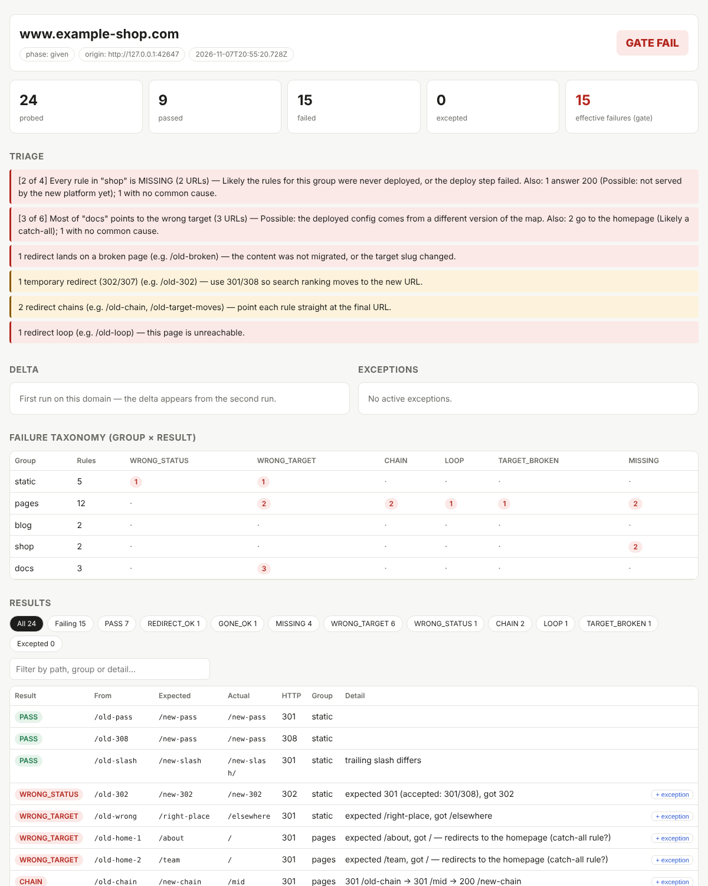

# CutoverGate

**A release gate for website migrations. Every legacy URL must land where your redirect map says it should, before DNS cutover and again after it.**

When a site moves to a new platform, the redirect map decides whether years of search ranking, bookmarks and backlinks survive. CutoverGate turns that map into a gate. It checks the map itself, probes every rule on the live origin, sorts the failures by cause, and blocks the release until the number of effective failures is zero.

[עברית ↓](#עברית)



## The flow

```
1. preflight   Check the map file. No HTTP requests.     → fix the map
2. (deploy)    Your platform registers the redirects.
3. probe       Probe every rule on staging.              → fix, redeploy, re-probe (the delta shows what changed)
4. gate PASS   Effective failures = 0                    → cutover approved
5. verify      After DNS cutover, probe the live domain  → compared against the last pre-cutover run
```

## Install

```bash
git clone https://github.com/veredlipimi/cutovergate && cd cutovergate
node bin/cutovergate.mjs --help        # Node 18+, no dependencies
# optional: npm link  →  then just `cutovergate …`
```

## The map

A CSV, TSV or JSON file. Only `from` and `to` are required.

```csv
from,to,status,group,note
/about-us.html,/about,301,static,
/blog/2019/05/hello-world.html,/blog/hello-world,301,blog,
/products.aspx?id=12,/shop/blue-chair,301,shop,
/old-promo,,410,retired,campaign ended
/press,*,301,static,any target is fine
```

- `status` defaults to 301. Use `410` or `404` for pages you retire on purpose.
- `group` labels a set of rules (section, content type, migration wave). The failure taxonomy groups failures by it.
- `to = *` means any redirect target is accepted.
- `enabled = false` keeps a row in the file but skips it.
- Common header names are recognized automatically: `old`/`new`, `source`/`target`, `old_url`/`new_url`, and others.

## Commands

### `preflight`: check the map before anything is deployed

```bash
cutovergate preflight --map map.csv --legacy-urls old-sitemap-urls.txt
```

| Severity | Code | Meaning |
|---|---|---|
| error | `MISSING_TARGET` | No target. The redirect would be skipped. |
| error | `DUPLICATE_SOURCE` | One source maps to two targets. Only one can survive. |
| error | `SELF_REDIRECT`, `LOOP_IN_MAP` | The rule redirects to itself, or the rules form a loop. |
| error | `INVALID_SOURCE` | The source is not a path or URL. |
| warning | `CHAIN_IN_MAP` | A target is also a source, so users get a chain. Point the rule at the final URL. |
| warning | `VARIANT_CONFLICT` | `/team.htm` and `/team/` point to different pages. |
| warning | `UNMAPPED_LEGACY_URL` | A known old URL has no rule, so it will 404. |
| warning | `QUERY_IN_SOURCE`, `UNENCODED_CHARS`, `TARGET_TOO_LONG`, `UNEXPECTED_STATUS` | Things many platforms handle differently from what you expect. |
| info | `VARIANT_DUPLICATE`, `DUPLICATE_ROW`, `EXTERNAL_TARGET`, `RETIRED_PAGE`, `ROW_DISABLED` | Expected, but worth knowing. |

It exits 1 when the map has errors.

### `probe`: test every rule on a live origin

```bash
cutovergate probe --map map.csv \
  --candidates "staging=https://new.staging.example,live=https://www.example.com" \
  --fingerprint "header:x-powered-by=NewCMS" \
  --exceptions exceptions.json --check-targets
```

**Origin auto-detection.** The candidates are probed in parallel. The first one that is served by the new platform wins; the fingerprint is a response header, or text in the page body. The run is labelled with its phase (`staging` before cutover, `live` after it). If no candidate matches (for example, the old server still answers), the site is reported as **NOT ON TARGET**, never as a pass.

Every hop is traced with `redirect: manual`:

| Result | Meaning |
|---|---|
| `PASS` | Redirects to the expected target with an accepted status (default 301/308). A trailing-slash difference is tolerated and noted. |
| `REDIRECT_OK` | A redirect exists. The map accepts any target (`*`). |
| `GONE_OK` | A retired page returns the expected 410/404. |
| `MISSING` | No redirect. The URL answers 404, or 200 (the old page is still live, or a catch-all route caught it). |
| `WRONG_TARGET` | Redirects, but to a different page. Redirects to the homepage are flagged. |
| `WRONG_STATUS` | Right target, wrong status, for example 302 instead of 301. |
| `CHAIN` | Reaches the target only through extra hops. |
| `LOOP` | A redirect loop. |
| `TARGET_BROKEN` | The redirect is right, but the destination page fails (with `--check-targets`). |
| `ERROR` | Timeout, DNS or network failure. Nothing was verified. |

**Failure taxonomy.** Failures are grouped by group × result, with triage hints:

- every rule in a group is MISSING → that group's rules were never deployed;
- most of a group goes to the wrong target → the deployed config comes from another version of the map;
- many old URLs answer 200 → the new platform is not serving yet, or a catch-all route swallows the paths;
- several URLs redirect to the homepage → a catch-all rule overrides specific rules, which search engines treat as a soft 404;
- many ERRORs → check VPN, DNS or rate limiting before trusting the run.

**Delta.** Every run is saved. From the second run on a domain, the delta shows:

- **Regressions**: rules that passed before and fail now. Investigate these immediately.
- **New failures**: rules not seen before that fail now.
- **Fixed**: rules that failed before and pass now.

**Exports.** Each run writes `redirect-qa-{domain}-{datetime}`:

- `.html`: a self-contained, filterable report;
- `.csv`: for a spreadsheet or a status email;
- `.json`: the full detail, for a ticket.

### When something gets worse: suspect changes and Slack

**Suspect changes.** A regression after a clean run almost always has a cause in between: a config deploy, a routing change, a CMS export. If the redirect config lives in a repository, point CutoverGate at it:

```bash
GITHUB_TOKEN=… cutovergate probe --map map.csv --origin https://www.example.com \
  --repo acme/site-config --repo-path redirects
```

When the delta shows regressions or new failures, the report lists the commits that landed in that repo (optionally only under `--repo-path`) between the previous run and this one, with their PR numbers. Nothing is fetched when nothing got worse. An API problem is shown in the report and never changes the gate. GitHub Enterprise works with `--github-api https://ghe.example.com/api/v3`. In `batch`, each site can set its own `repo` and `repoPath`.

**Slack.** Send the result to a channel through an incoming webhook:

```bash
cutovergate verify … --notify-slack "$CUTOVERGATE_SLACK_WEBHOOK" --notify-on fail
```

| `--notify-on` | Posts when |
|---|---|
| `fail` (default) | the gate fails, or anything regressed even though the gate passes |
| `regression` | something that passed before fails now |
| `always` | every run |

The message carries the gate, the counts, the regressions and failures, the top suspect commits and the high-severity triage hints. `batch` posts one summary for all sites. The webhook can also come from `$CUTOVERGATE_SLACK_WEBHOOK`.

### The gate

> The release is blocked until **effective failures = 0**.

| | Normal | `--strict` |
|---|---|---|
| MISSING, WRONG_TARGET, CHAIN, LOOP… | block | block |
| ERROR (network) | can be excepted | **always blocks**, even when excepted |

`probe` exits 1 when the gate fails, so it fits straight into CI (see `.github/workflows/redirect-gate.yml`).

### `exceptions`: temporary waivers that expire

```bash
cutovergate exceptions add --file exceptions.json --path "/press" --ttl 14 --reason "Rebuilt next sprint, WEB-123"
cutovergate exceptions list --file exceptions.json
```

1. **A reason is mandatory.** An exception without a reason is ignored and reported.
2. **Set an expiry.** Use `--ttl 7|14|30|90` for temporary waivers. Use `none` only for pages that were truly retired.
3. **Excepted rows are still probed.** They show as EXCEPTED and are left out of the gate count.
4. **Expired exceptions stop applying automatically.** Exceptions that expire within 7 days get a warning.
5. **Glob paths are supported**, for example `/archive/*`. Every failing row in the HTML report has a "+ exception" button that copies the command.

### `verify`: the post-cutover pass

```bash
cutovergate verify --map map.csv --candidates "staging=…,live=https://www.example.com" --fingerprint "header:x-powered-by=NewCMS"
```

This is `probe` with two additions: the run must resolve to the `live` origin, and the delta compares it with the last **pre-cutover** run. Any regression found after cutover needs attention right away.

### `batch`: many sites, one table

```bash
cutovergate batch --sites sites.json --strict
```

The table shows, per site: gate, phase, passed/probed, and the first failures. It is also written as CSV and JSON. Sites not yet on the new platform are listed as SKIPPED.

### `qa`: the redirect is right, but does the page work?

CutoverGate checks that every old URL lands on the right page. [web-qa-agent](https://github.com/veredlipimi/web-qa-agent) checks that the page it lands on actually works. `qa` connects the two:

```bash
cutovergate qa --map map.csv --candidates "staging=…,live=…" --fingerprint "header:…" --max-pages 20 --lang he
```

1. It runs the full gate. If the gate fails, page QA is skipped; pass `--force` to QA only the pages that already land correctly.
2. It takes the destination pages from the map. Duplicates are removed, and a capped run still covers every `group` (round-robin).
3. It runs the agent's automated pass on exactly those pages: audit (accessibility, performance, RTL, console/network, passive security), the field matrix, and a report. There is no full-site crawl.
4. It writes `claude-prompt.md` into the QA folder. Paste it into Claude Code to continue with the exploratory pass.

The agent is found at `--agent`, `$WEB_QA_AGENT` or `~/.claude/skills/web-qa-agent`. The link works the other way too: when CutoverGate is installed, the agent's own redirect check uses it as its engine, so both tools always classify a redirect the same way.

### `harvest`: no redirect map? Build one from the archive

```bash
cutovergate harvest --old-domain old-shop.example --out map.csv --mode any --limit 150
cutovergate probe --map map.csv --origin https://old-shop.example --domain www.new-shop.example --check-targets
```

`harvest` pulls the old site's pages from the Wayback Machine, leaving out assets, feeds, admin paths and tracking parameters.

- `--mode same-path` is for a pure domain move, where the same path is expected on the new domain.
- `--mode any` is for a platform change. Any target is accepted, unless it is the homepage (a soft 404) or a broken page.

### `files`: are linked documents still there?

```bash
cutovergate files --origin https://www.example.com --pages pages.txt     # scan pages for PDF/DOCX/… links
cutovergate files --origin https://old.example.com --urls file-hrefs.txt  # or check a list of hrefs
```

Each file is checked with HEAD, falling back to a GET for one byte when HEAD is refused. A link to a PDF that answers with an HTML page is reported as `SOFT_404`.

## Good citizenship

CutoverGate only sends GET and HEAD requests. Concurrency is bounded (`--concurrency`, default 6), and you can add a delay between requests (`--delay-ms`). Every request carries an identifiable User-Agent. Probe only sites you are responsible for.

## Tests

```bash
npm test     # 28 tests against local mock sites, covering every result type, gate rule, exception rule, CLI exit code, suspect changes and Slack
```

## Credits

Built by Vered Li from hands-on experience gating large-scale website migrations. The gate, exception TTL, strict mode, delta and failure taxonomy come from her original site-scanner tool, rebuilt here as a generic open-source project.

MIT © Vered Li

---

## עברית

**CutoverGate הוא שער שחרור להגירת אתרים. הוא מוודא שכל כתובת ישנה מגיעה לאן שמפת ההפניות אומרת, לפני העברת ה-DNS ואחריה.**

**התהליך:**
1. `preflight` בודק את קובץ המפה בלי לשלוח אף בקשה: יעדים חסרים, מקור כפול, לולאות, שרשראות, וכתובות ישנות ידועות שאין להן כלל.
2. `probe` בודק כל כלל על האתר החי. הכלי מזהה לבד אם האתר עדיין ב-staging או כבר live. כל תוצאה מסווגת לאחת הקטגוריות: PASS, MISSING, WRONG_TARGET, WRONG_STATUS, CHAIN, LOOP, TARGET_BROKEN, ERROR.
3. **השער:** השחרור חסום עד שמספר הכשלים האפקטיביים הוא 0. במצב strict, שגיאות רשת חוסמות תמיד.
4. **פטורים (exceptions):** חובה לכתוב סיבה ולקבוע תוקף (7, 14, 30 או 90 ימים, או ללא תוקף). פטור שפג תוקפו מפסיק לחול לבד.
5. **דלתא:** החל מההרצה השנייה הדוח מציג רגרסיות, כשלים חדשים ומה תוקן.
6. `verify` רץ אחרי ההעברה ומשווה מול ההרצה האחרונה שלפניה.
7. `batch` מריץ את הבדיקה על הרבה אתרים בבת אחת, ו-`files` בודק שקבצי PDF ומסמכים מקושרים עדיין זמינים.
8. **כשמשהו נשבר:** עם `--repo` הדוח מציג את ה-commits שנכנסו לריפו של ההגדרות בין ההרצה הקודמת לנוכחית, כ"חשודים" לרגרסיה. עם `--notify-slack` נשלחת הודעה לערוץ כשהשער נכשל או כשיש רגרסיה.
9. `qa` מחבר ל-[web-qa-agent](https://github.com/veredlipimi/web-qa-agent): אחרי שהשער עובר, הסוכן בודק את עמודי היעד עצמם (נגישות, טפסים, RTL, ביצועים), וכך יודעים לא רק שההפניה נכונה אלא גם שהעמוד שמגיעים אליו תקין.

**ייצוא:** דוח HTML עם סינון, קובץ CSV לגיליון או למייל עדכון, וקובץ JSON לכרטיס.

**התקנה:** `git clone https://github.com/veredlipimi/cutovergate`. נדרש Node 18 ומעלה, בלי תלויות.
